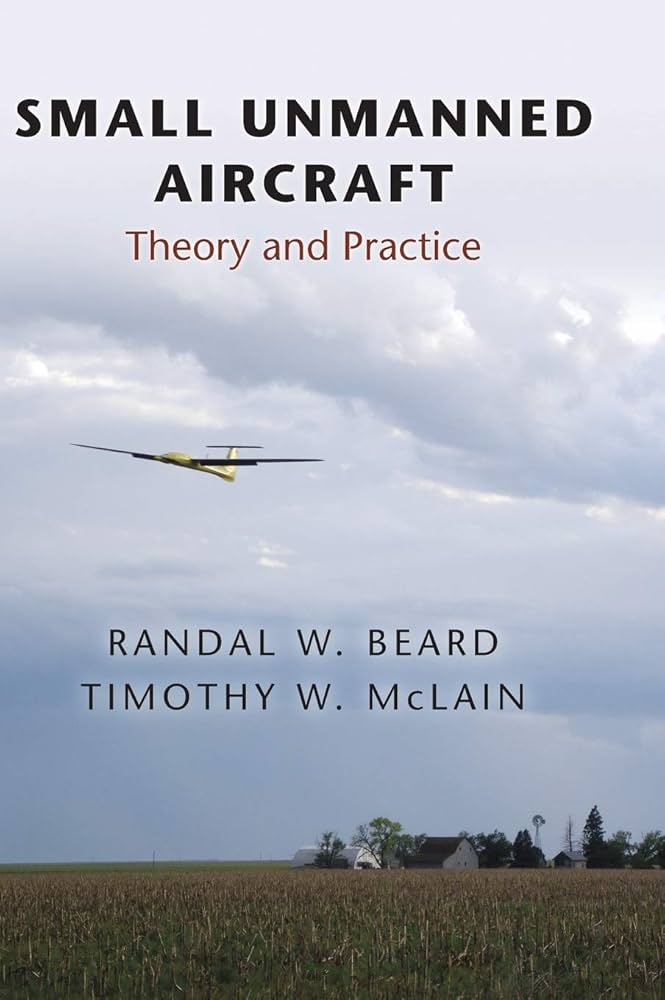
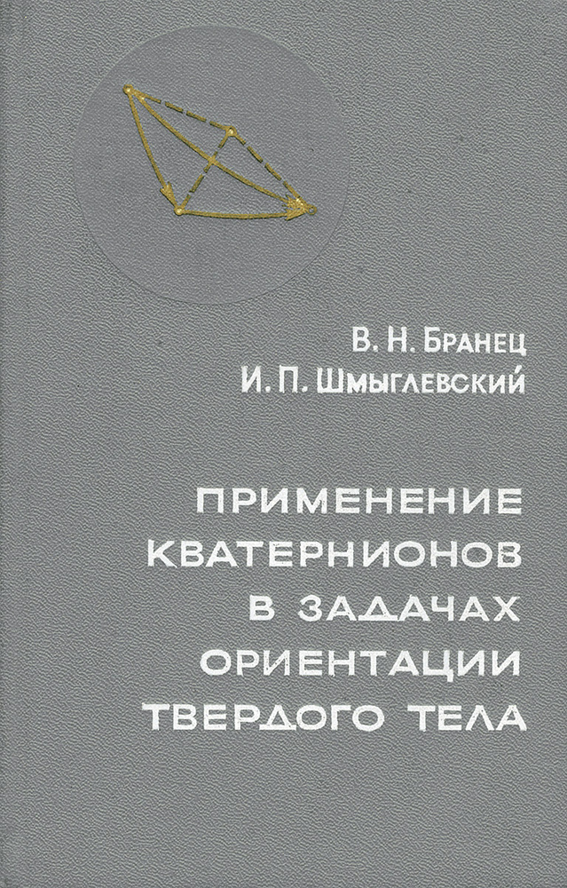

# Динамика полета 2026

Данный репозиторий содержит материалы лекций и примеры реализации модели динамики летательного аппарата в среде MATLAB.Simulink

## Литература

### Малые беспилотные летательные аппараты: теория и практика

Основаная книга курса. Охватывает широкий спектр тем: от основ аэродинамики и динамики полета ЛА до реализации автопилота

|Ссылка на материалы|Описание|
|--|--|
|[Ссылка](https://disk.yandex.ru/i/3a8as5FZSdCsAA)|Перевод на русский язык. Включает много ошибок и неточностей в определениях|
|[Ссылка](https://disk.yandex.ru/i/wK8s09ydbsNyGg)|Текущая версия книги, редактируемая авторами. Рекомендуется, как основная книга курса. На английском|

### Ориентация твердого тела

Книга посвящена вопросам применения кватернионов в задачах ориентации твердого тела. Рассмытриваются кинематические уравнения и методы численного решения

[.djvu](https://disk.yandex.ru/d/lqW7ZpLIpROcyw)
[.pdf](https://disk.yandex.ru/i/lx3YM1tswjKBzw)

### Ютуб-канал Кристофера Лама и его репозиторий

Ютуб-канал богат на видео-плейлисты институтских курсов по теории управления, дифференциальным уравнениям, динамики полета. Хорошо структурированные материалы лекций и кода на репозитории отлично дополняют видео-лекции. Правда, все на английском  

|[Канал](https://www.youtube.com/watch?v=fAZZJgm096w&list=PLxdnSsBqCrrEx3A6W94sQGClk6Q4YCg-h)|[Репозиорий](https://github.com/clum/YouTube)|